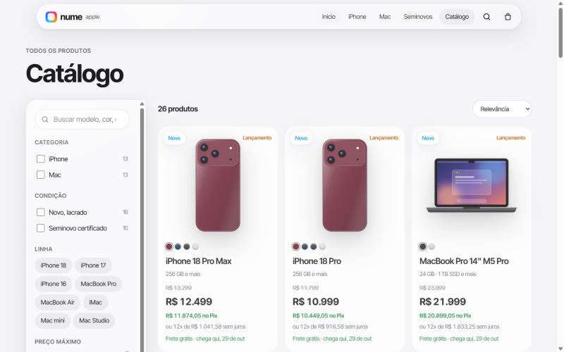
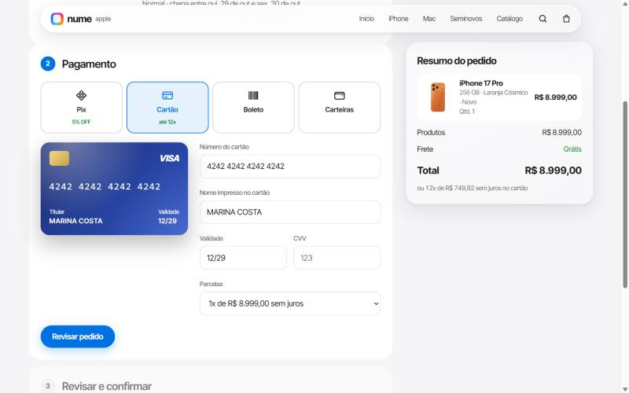
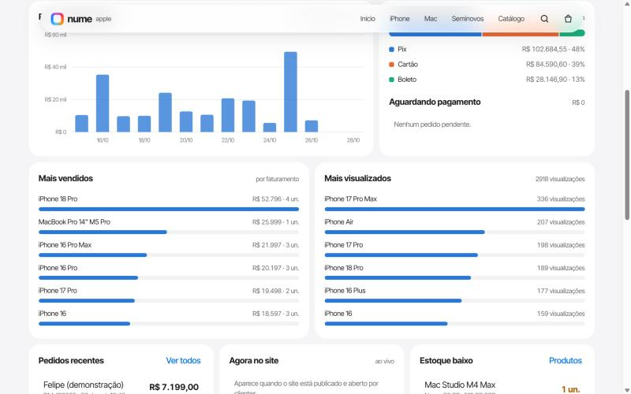
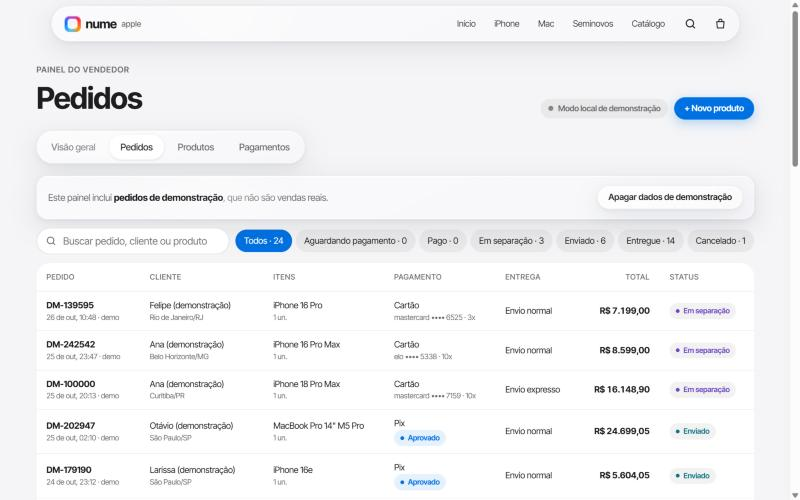

# Nume Apple · loja e painel do vendedor

Protótipo de e-commerce para uma revenda de iPhones e Macs, novos e seminovos. Tem vitrine no estilo do site da Apple, catálogo com busca e filtros, página de produto com prazo de entrega por CEP, checkout com Pix, cartão e boleto, e um painel do vendedor com pedidos, produtos, pagamentos e métricas ao vivo.

Tudo roda em um único arquivo HTML, sem framework e sem etapa de build obrigatória.

**[Ver a demonstração](https://SEU-USUARIO.github.io/SEU-REPOSITORIO/)** · painel do vendedor: `…/#gestao-x7r4kq`


## Funcionalidades

### Loja
- **Vitrine de lançamentos** com troca de cor ao vivo e efeito de vidro líquido (*liquid glass*) no menu, nos cartões e na sacola.
- **Aparelhos desenhados em SVG** gerados a partir dos dados de cada produto (cor, modelo de câmera, tipo de Mac). Eles giram com o mouse, viram ao passar o cursor e mudam de cor.
- **Catálogo** com busca sem acento, filtros por categoria, condição, linha e preço, chips de filtros ativos e ordenação. No celular, os filtros abrem numa aba que sobe da parte de baixo da tela.
- **Página do produto** com galeria, escolha de cor e armazenamento, preço no Pix, parcelamento em até 12x e prazo de entrega calculado pelo CEP (normal, expressa e retirada na loja). Nos seminovos aparecem a saúde da bateria e a garantia.
- **Busca rápida** com `Ctrl + K` ou `/`, navegável pelo teclado.
- **Checkout em três etapas** (entrega, pagamento, revisão), com máscaras de CEP, CPF, telefone e cartão, validação do número do cartão (Luhn), cartão animado que mostra a bandeira e vira ao digitar o CVV, QR Code Pix e boleto de demonstração.

| Catálogo | Produto | Checkout |
|---|---|---|
|  |  |  |

### Painel do vendedor
- **Visão geral ao vivo:** faturamento e pedidos dos últimos 30 dias, ticket médio, conversão, visitantes no site agora, faturamento por dia, mais vendidos, mais visualizados, formas de pagamento e estoque baixo.
- **Pedidos:** busca, filtro por status e ficha do pedido com mudança de status, código de rastreio e CPF mascarado.
- **Produtos:** cadastro e edição com prévia ao vivo, estoque, ocultar da loja, opções com preço adicional, cores, dados do seminovo e envio de foto.
- **Pagamentos:** aprovados, pendentes e estornados, e lista de transações.
- **Pedidos de demonstração** gerados com um clique e apagados com outro.

| Visão geral | Gráficos | Pedidos | Cadastro |
|---|---|---|---|
|  |  |  |  |


## Como funciona

O mesmo código roda em dois modos:

| | Demonstração (GitHub Pages ou arquivo local) | Publicado como Claude Artifact |
|---|---|---|
| Catálogo | Embutido no código | Banco de dados compartilhado |
| Pedidos e métricas | Só na memória da aba | Gravados no banco, em tempo real |
| Painel | Aberto, para demonstração | Só para contas de Editor |
| Visitantes ao vivo | Indisponível | Presença em tempo real |
| Fotos | Ilustrações em SVG | Envio de fotos pelo painel |

No modo publicado, a proteção dos dados não depende da tela: regras no servidor fazem com que um comprador só grave os próprios pedidos, só Editores leiam pedidos e pagamentos, e ninguém além deles altere produtos. O número do cartão e o CVV nunca são gravados, só a bandeira e os 4 últimos dígitos.

**Tecnologias:** HTML, CSS e JavaScript puros, SVG gerado por código, `backdrop-filter` para o vidro líquido e fonte Inter Tight como reserva para a SF Pro.

## Rodar localmente

Não precisa instalar nada. Abra o `index.html` no navegador, ou sirva a pasta:

```bash
python -m http.server 5173
```

Depois acesse `http://localhost:5173`. O painel do vendedor fica em `http://localhost:5173/#gestao-x7r4kq`.

## Estrutura

```
nume-apple.html     código-fonte (corpo da página, no formato de Claude Artifact)
index.html          página completa gerada para o GitHub Pages
scripts/build.mjs   gera o index.html a partir do nume-apple.html
docs/screenshots/   imagens deste README
```

Depois de editar o `nume-apple.html`, gere o `index.html` de novo:

```bash
node scripts/build.mjs
```

## Próximos passos

- Gateway de pagamento real (Mercado Pago, Pagar.me ou Stripe) com confirmação por webhook.
- Backend próprio (por exemplo, Supabase) e hospedagem com proteção contra DDoS e robôs.
- Login do vendedor com verificação em duas etapas e adequação à LGPD.
- Baixa automática de estoque a cada venda.

## Aviso

Protótipo feito para uma revenda independente. Apple, iPhone, Mac, MacBook e iMac são marcas da Apple Inc. Preços, estoque e especificações são ilustrativos, e os pagamentos são simulados.

Desenvolvido com auxílio do Claude (Anthropic).
